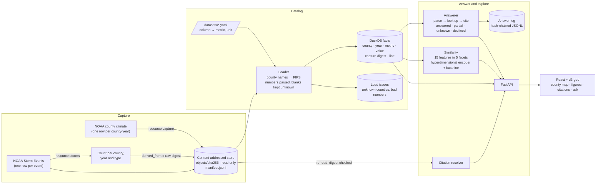

# Resource Information Platform

[](https://github.com/10vin10-cmd/global-resource-information-platform/actions/workflows/ci.yml)

Answers questions about Texas county weather (temperature, rainfall and severe weather) with figures quoted exactly as NOAA's records state them. Every figure has a citation that opens the exact line of the captured file it came from. When the records don't hold the answer, the platform says so instead of estimating, and it declines forecasts, causes and advice.

It starts with weather. Each source is described by a small YAML spec, so other resource data plugs in the same way.


```bash
pip install -e ".[dev]"
resource sample                   # generate and capture the synthetic sample
resource ask "How much rain fell in Harris County in 2017?"
resource similar Harris 2017 --evaluate
(cd web && npm ci && npm run build) && resource serve    # http://127.0.0.1:8000
pytest && (cd web && npm test)
```

> **Sample data is synthetic.** It is generated in the layout of the NOAA files (a county climate export, and Storm Events records one row per event, with blanks, zone-based events and a statewide row), so everything runs with no downloads. Every capture made from it is flagged, and the app shows that flag next to each figure. To use real data, see [Real data](#real-data).

---

## Architecture



| Part | What it does | Code |
|---|---|---|
| **Capture** | Stores each source file under its SHA-256 digest, read-only, with a manifest line recording the publisher, URL, time and whether it is synthetic. A revised file becomes a new capture; the old one is kept, so earlier answers still resolve. | [`capture.py`](resource_platform/capture.py) |
| **Storm counts** | NOAA publishes one row per event. This step counts county events by type and year and sums the stated property damage. Zone-based events (heat, drought) aren't tied to a county, so they are skipped and reported, never spread across counties. The counted table is captured with `derived_from` naming the raw file, so its citations lead back to what NOAA published. | [`storms.py`](resource_platform/storms.py) |
| **Catalog** | A YAML spec per dataset maps source columns to metrics and units. The loader matches county names to FIPS codes (`DE WITT COUNTY`, `DeWitt`), keeps blanks as unknown, and records anything unreadable as a load issue instead of dropping it. | [`catalog.py`](resource_platform/catalog.py), [`datasets/`](datasets) |
| **Answers** | Parses the question (counties, measures, years or ranges) and looks each figure up. Each answer is one of four outcomes, and every one is logged. | [`answer.py`](resource_platform/answer.py) |
| **Similarity** | Finds counties that had a similar year, and says which facets they share. | [`similarity.py`](resource_platform/similarity.py) |
| **API and app** | FastAPI serves the API and the built React app on one port. The app shades counties by any measure, lists a county's figures with openable citations, shows counties with a similar year, and takes questions. | [`api.py`](resource_platform/api.py), [`web/`](web) |

## Answers: cited, or an honest no

| Outcome | When | Example |
|---|---|---|
| **answered** | Every figure asked for was found | "Average daily high in El Paso and Lubbock from 2020 to 2022": six cited figures |
| **partial** | Some figures found, the rest listed as missing | A county-year whose precipitation isn't reported yet |
| **unknown** | In scope, but the records have no figure | "Rainfall in Bexar County in 2001" |
| **declined** | Out of scope, with the reason | "Will it rain tomorrow?" (forecast), "Why was 2022 so dry?" (cause), "Should farmers plant early?" (advice), an unknown county |


Rules the answers follow:
- **Quoted, not computed.** "Storms in Potter County" returns each event type with its citation, and a note that the platform doesn't add the types into a total the source never stated.
- **Caveats travel with the figure.** Damage answers say they are National Weather Service estimates; event counts say they were counted from NOAA's event records.
- **Daily high isn't the average.** "Average daily high temperature" asks for the high, not the mean.
- **Tamper-evident log.** Each logged answer holds the hash of the one before, so editing any past entry breaks the chain from that point (`resource log` verifies it).
- **Gaps are data.** `resource log` counts unanswered questions by reason. Those counts show which sources to capture next.
- **Ambiguous names are handled.** County names that are also words (Real, Young, Hall) count only when capitalised or followed by "County", and "Brazos River" doesn't match Brazos County.

## Similarity: which counties had a similar year

Each county-year becomes 15 features in five facets:

| Facet | Features |
|---|---|
| climate | average temperature, daily range (high minus low), precipitation (log) |
| departure | temperature and precipitation against the county's own average over the loaded years |
| trend | 3-year change in temperature and in precipitation |
| storm mix | share of each of the six event types |
| storm intensity | number of events (log), property damage (log) |

Two methods compare them:
- **Hyperdimensional encoder.**
  - Each value is ranked within its feature and put into one of 16 levels.
  - Levels are random ±1 vectors of 8,192 dimensions, built so neighbouring levels share most signs and the extremes are close to unrelated.
  - Each feature's level vector is bound to a random feature-ID vector (elementwise product), and the results are summed per facet and overall.
  - Unknown values are left out of the sum, not filled with a guess.
  - Because each facet has its own vector, a match can be explained: "most alike in departure and storm mix".
- **Baseline.** Cosine similarity of z-scored features, with unknowns set to the mean.

**How it's checked, with no labels.** Weather is spatially coherent, so counties that had a similar year should mostly be near each other. `resource similar Harris 2017 --evaluate` measures the mean distance between each county and its five same-year matches, against random pairs. On the synthetic sample (2,000 county-years):

| Check | Encoder | Baseline |
|---|---|---|
| Mean distance to the 5 matches | 214.5 km | 204.8 km |
| Mean distance between random county pairs | 441.1 km | |
| Matches shared by both methods (top 5) | 44.6% | |

Both methods find geographically coherent matches at about half the random distance; the baseline is slightly tighter. The encoder's case is the per-facet explanation and how it handles missing values, not a better score. These numbers describe synthetic data, so they show the method works as intended, not how it performs on real weather. Similar means a similar year; it says nothing about causes.

## Real data

1. **County climate.** Download annual county series from [NOAA Climate at a Glance](https://www.ncei.noaa.gov/access/monitoring/climate-at-a-glance/county/time-series) and combine them into one CSV with the columns named in [`datasets/county_climate.yaml`](datasets/county_climate.yaml) (or edit the `column:` entries to match your file).
2. **Storm events.** Download the yearly `StormEvents_details` files from the [Storm Events Database](https://www.ncei.noaa.gov/stormevents/) and decompress them.
3. Capture, count and rebuild:

```bash
resource capture county_climate texas_county_climate.csv --source-url <where it came from>
resource storms StormEvents_details-*_d2021_*.csv StormEvents_details-*_d2022_*.csv
resource build     # prints load issues: rows it couldn't place, cells it couldn't read
```

`resource storms` reports how many rows it skipped and why (zone-based events, types outside the six categories). The newest capture of each dataset is used; older captures stay in the store so their citations keep resolving.

## API

| Endpoint | Returns |
|---|---|
| `GET /api/meta` | Datasets, metrics, years, synthetic flag |
| `GET /api/map/{metric}/{year}` | One cited value per county |
| `GET /api/counties/{fips}/{year}` | Every cited figure for a county-year |
| `GET /api/similar/{fips}/{year}?k=5&method=hdc` | Counties with a similar year, with per-facet scores |
| `POST /api/ask` `{"question": "…"}` | Answer with status, cited statements, missing figures, reason, notes |
| `GET /api/citations/{id}` | The source line behind a citation, re-read after checking the file's digest, and the raw capture it was counted from |
| `GET /api/log` | Answer-log integrity and unanswered questions by reason |

## Layout

```
resource_platform/capture.py      content-addressed store and manifest
resource_platform/storms.py       NOAA Storm Events → county-year counts
resource_platform/catalog.py      dataset specs, loader, facts table, citation resolver
resource_platform/answer.py       question parsing, answers, hash-chained log
resource_platform/similarity.py   features, hyperdimensional encoder, baseline, evaluation
resource_platform/api.py          FastAPI app (also serves web/dist)
resource_platform/sample.py       synthetic sample generator
datasets/                         one YAML spec per dataset
web/                              React + TypeScript + d3-geo app (county boundaries from us-atlas)
tests/                            39 Python tests;  web/src/**/*.test.*  Vitest tests
```

## Limitations

- The question parser uses patterns, not a language model. It handles counties, measures, years and ranges, and declines what it can't place rather than guessing.
- Annual figures only. Monthly climate and individual events would need their own datasets.
- County boundaries are the US Census cartographic boundaries (via `us-atlas`), simplified for display.

## License

MIT
