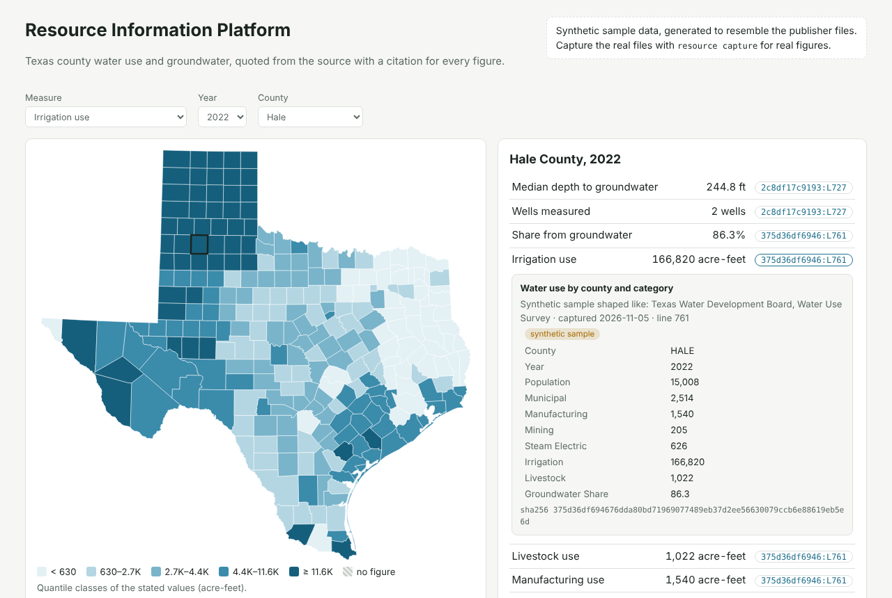
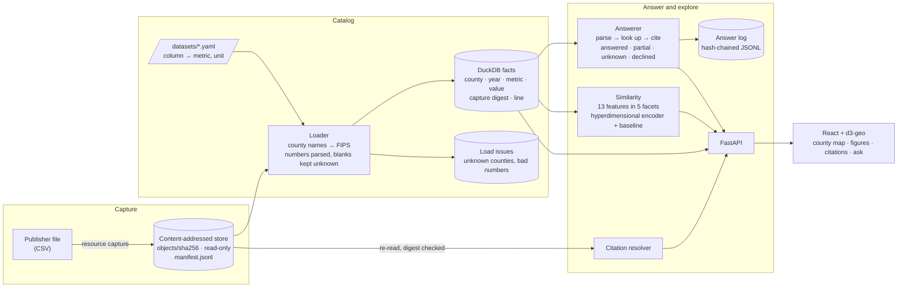
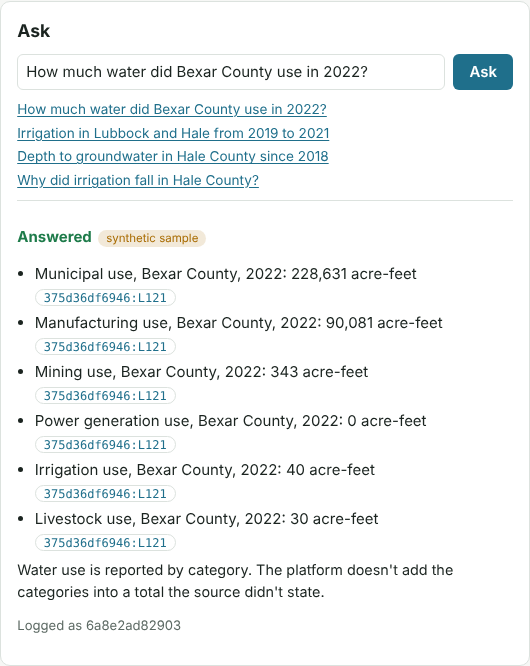

# Resource Information Platform

[](https://github.com/10vin10-cmd/global-resource-information-platform/actions/workflows/ci.yml)

Answers questions about Texas county water use and groundwater with figures quoted exactly as the source states them. Every figure has a citation that opens the exact line of the captured file it came from. When the sources don't hold the answer, the platform says so instead of estimating, and it declines forecasts, causes and advice.

It starts with Texas water. Each source is described by a small YAML spec, so other resources (energy, land, minerals) plug in the same way.



```bash
pip install -e ".[dev]"
resource sample                   # generate and capture the synthetic sample
resource ask "How much water did Bexar County use in 2022?"
resource similar Hale 2022 --evaluate
(cd web && npm ci && npm run build) && resource serve    # http://127.0.0.1:8000
pytest && (cd web && npm test)
```

> **Sample data is synthetic.** It is generated to look like the publisher files (same columns, blanks, withheld cells, a state-total row), so everything runs with no downloads. Every capture made from it is flagged, and the app shows that flag next to each figure. To use real data, see [Real data](#real-data).

---

## Architecture



| Part | What it does | Code |
|---|---|---|
| **Capture** | Stores each source file under its SHA-256 digest, read-only, with a manifest line recording the publisher, URL, time and whether it is synthetic. A revised file becomes a new capture; the old one is kept, so earlier answers still resolve. | [`capture.py`](resource_platform/capture.py) |
| **Catalog** | A YAML spec per dataset maps source columns to metrics and units. The loader matches county names to FIPS codes (tolerating `DE WITT` / `DeWitt`), keeps blanks and withheld cells (`*`) as unknown, and records anything unreadable as a load issue instead of dropping it. | [`catalog.py`](resource_platform/catalog.py), [`datasets/`](datasets) |
| **Answers** | Parses the question (counties, measures, years or ranges) and looks each figure up. Each answer is one of four outcomes, and every one is logged. | [`answer.py`](resource_platform/answer.py) |
| **Similarity** | Finds counties in a similar situation in a year, and says which facets they share. | [`similarity.py`](resource_platform/similarity.py) |
| **API and app** | FastAPI serves the API and the built React app on one port. The app shades counties by any measure, lists a county's figures with openable citations, shows similar counties, and takes questions. | [`api.py`](resource_platform/api.py), [`web/`](web) |

## Answers: cited, or an honest no

| Outcome | When | Example |
|---|---|---|
| **answered** | Every figure asked for was found | "Irrigation in Lubbock and Hale from 2019 to 2021": six cited figures |
| **partial** | Some figures found, the rest listed as missing | A county-year where the source left mining blank |
| **unknown** | In scope, but the sources have no figure | "Water use in Bexar County in 2001" |
| **declined** | Out of scope, with the reason | "Why did irrigation fall…" (cause), "…in 2030" (forecast), "Should Bexar pump more?" (advice), an unknown county |



Rules the answers follow:
- **Quoted, not computed.** "How much water did Bexar use?" returns each category the source reports, with a note that the platform doesn't add them into a total the source never stated.
- **Caveats travel with the figure.** A groundwater median from fewer than five wells is flagged as unreliable.
- **Tamper-evident log.** Each logged answer holds the hash of the one before, so editing any past entry breaks the chain from that point (`resource log` verifies it).
- **Gaps are data.** `resource log` counts unanswered questions by reason. Those counts show which sources to capture next.
- **Ambiguous names are handled.** County names that are also words (Real, Young, Hall) count only when capitalised or followed by "County", and "Edwards Aquifer" or "Brazos River" doesn't match a county.

## Similarity: which counties were in the same situation

Each county-year becomes 13 features in five facets:

| Facet | Features |
|---|---|
| size | population (log) |
| use mix | share of each of the six use categories |
| intensity | water use per person (log) |
| trend | 3-year change in water use and in population |
| groundwater | share from groundwater, depth to water, 3-year change in depth |

Two methods compare them:
- **Hyperdimensional encoder.**
  - Each value is ranked within its feature and put into one of 16 levels.
  - Levels are random ±1 vectors of 8,192 dimensions, built so neighbouring levels share most signs and the extremes are close to unrelated.
  - Each feature's level vector is bound to a random feature-ID vector (elementwise product), and the results are summed per facet and overall.
  - Unknown values are left out of the sum, not filled with a guess.
  - Because each facet has its own vector, a match can be explained: "most alike in intensity and groundwater".
- **Baseline.** Cosine similarity of z-scored features, with unknowns set to the mean.

`resource similar Hale 2022 --evaluate` on the synthetic sample (1,975 county-years):

| Check | Encoder | Baseline |
|---|---|---|
| Nearest neighbour is the same county in another year | 78.0% | 75.2% |
| Top-5 neighbours from the same generated region (tested) | above 80% | above 80% |
| Top-10 neighbours shared by both methods | 37.9% | |

The methods agree on the broad picture but rank neighbours differently, which is the useful case for a human reviewer comparing them. These numbers describe synthetic data generated by region, so they show the method works as intended, not how it performs on real counties. Similar means a similar situation; it says nothing about causes.

## Real data

1. Download the county file from the publisher. The source pages are in each dataset spec: [Water Use Survey historical estimates](https://www.twdb.texas.gov/waterplanning/waterusesurvey/estimates) for water use.
2. If its column names differ, edit the `column:` entries in [`datasets/water_use.yaml`](datasets/water_use.yaml).
3. Capture and rebuild:

```bash
resource capture water_use ~/Downloads/water_use_by_county.csv --source-url <the file's URL>
resource build        # prints load issues: rows it couldn't place, cells it couldn't read
```

The newest capture of each dataset is used; older captures stay in the store so their citations keep resolving.

## API

| Endpoint | Returns |
|---|---|
| `GET /api/meta` | Datasets, metrics, years, synthetic flag |
| `GET /api/map/{metric}/{year}` | One cited value per county |
| `GET /api/counties/{fips}/{year}` | Every cited figure for a county-year |
| `GET /api/similar/{fips}/{year}?k=5&method=hdc` | Similar counties with per-facet scores |
| `POST /api/ask` `{"question": "…"}` | Answer with status, cited statements, missing figures, reason, notes |
| `GET /api/citations/{id}` | The source line behind a citation, re-read after checking the file's digest |
| `GET /api/log` | Answer-log integrity and unanswered questions by reason |

## Layout

```
resource_platform/capture.py      content-addressed store and manifest
resource_platform/catalog.py      dataset specs, loader, facts table, citation resolver
resource_platform/answer.py       question parsing, answers, hash-chained log
resource_platform/similarity.py   features, hyperdimensional encoder, baseline, evaluation
resource_platform/api.py          FastAPI app (also serves web/dist)
resource_platform/sample.py       synthetic sample generator
datasets/             one YAML spec per source dataset
web/                  React + TypeScript + d3-geo app (county boundaries from us-atlas)
tests/                34 Python tests;  web/src/**/*.test.*  Vitest tests
```

## Limitations

- The question parser uses patterns, not a language model. It handles counties, measures, years and ranges, and declines what it can't place rather than guessing.
- Two dataset specs are included. More sources mean more YAML specs, and a source that isn't one row per county-year needs its own loader.
- County boundaries are the US Census cartographic boundaries (via `us-atlas`), simplified for display.

## License

MIT
